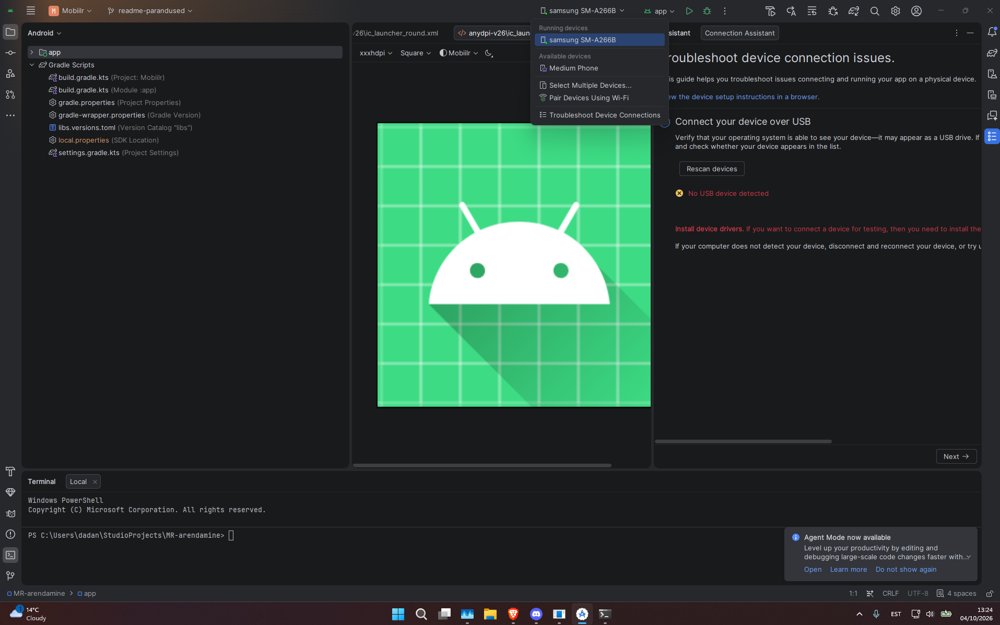
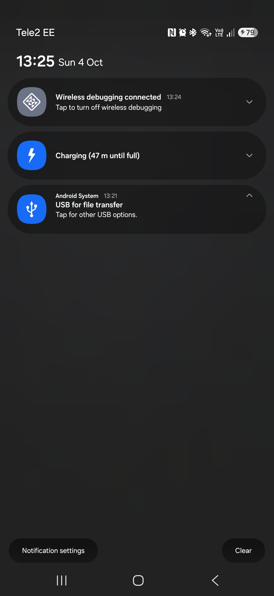
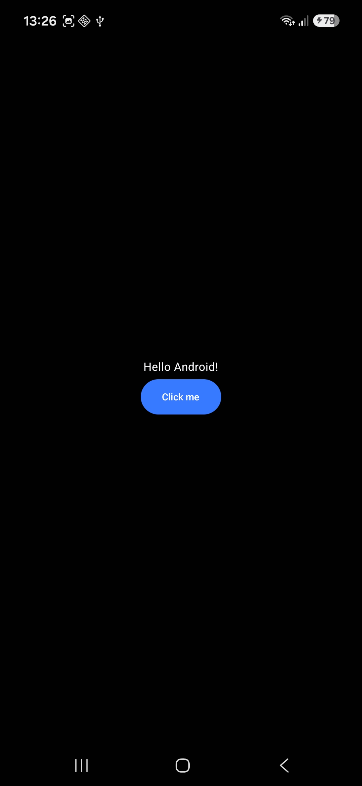
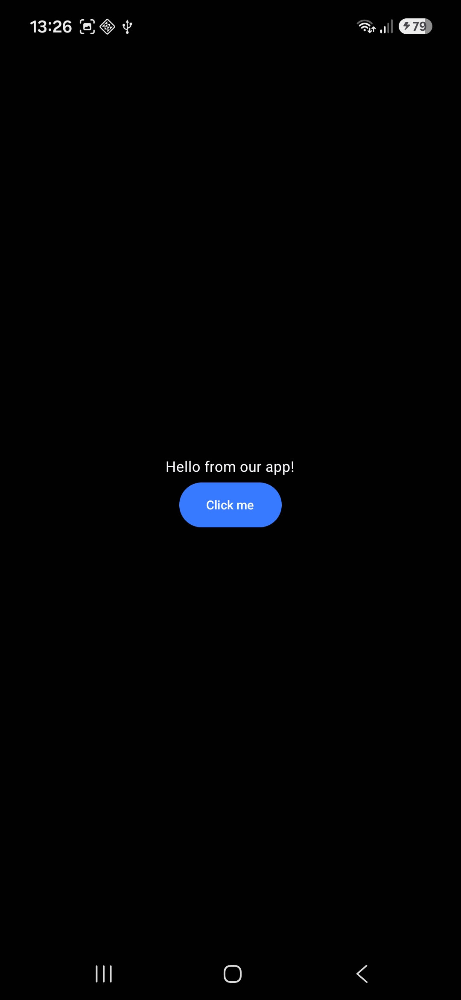
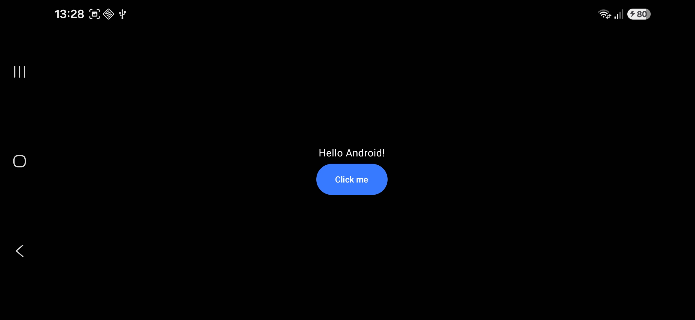
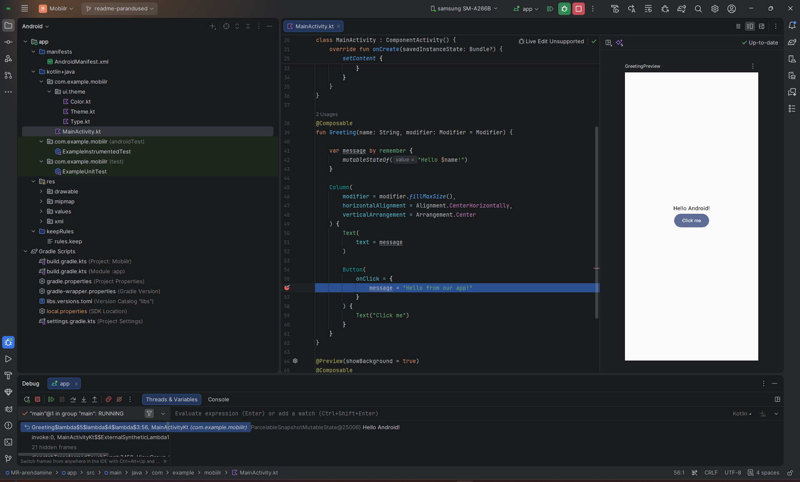

# Mobiilrakenduste arendamine - Grupp 0

## Tech stack

- Android Studio Quail 4 (2026.1.4)
- Android Gradle Plugin 9.4.1
- Kotlin 2.2.10
- Jetpack Compose (BOM 2026.02.01), Material 3
- compileSdk ja targetSdk 37, minSdk 24 (Android 7.0)
- Java 11

---

## Installatsioon

### Eeldused

- Android Studio Quail 4 (2026.1.4) või uuem
- Android SDK Platform 37 (Tools → SDK Manager)
- Git
- Android Emulator või füüsiline Android-seade (Android 7.0 või uuem)

### 1. Projekti hankimine

```bash
git clone https://github.com/vaikotuul/MR-arendamine
```

Ava kloonitud kaust Android Studios (File → Open) ja oota, kuni Gradle'i sünkroniseerimine lõpeb.

### 2. Käivitusseade

#### Emulaator

Ava Tools → Device Manager → Create Virtual Device. Vali profiil Medium Phone või Pixel 10 ja süsteemipilt Android 17.0 (API 37).

#### Füüsiline seade USB-ga

1. Ava telefonis Settings → About phone → Software information ja vajuta Build number 7 korda.
2. Lülita Developer options all sisse USB debugging.
3. Ühenda telefon USB-kaabliga ja luba telefonis küsimus Allow USB debugging?.

#### Füüsiline seade Wi-Fi kaudu

Meie ühendasime telefoni Wi-Fi kaudu, sest arvuti ei näinud seda USB-ga (vt Paigalduse probleemid). Arvuti ja telefon peavad olema samas Wi-Fi võrgus.

1. Ava telefonis Developer options → Wireless debugging, lülita see sisse ja vali Pair device with pairing code. Telefon näitab koodi ning IP-aadressi ja porti.
2. Käivita arvutis PowerShellis:

```powershell
& "$env:LOCALAPPDATA\Android\Sdk\platform-tools\adb.exe" pair IP:PAARITAMISE_PORT
```

3. Sisesta telefonis näidatud kood.
4. Ühenda seade Wireless debugging põhiekraanil näidatud IP-aadressi ja pordiga:

```powershell
& "$env:LOCALAPPDATA\Android\Sdk\platform-tools\adb.exe" connect IP:PORT
```

Telefon ilmub nüüd Android Studio seadmete rippmenüüsse.





### 3. Rakenduse käivitamine

Vali seade rippmenüüst ja vajuta Run (roheline kolmnurk). Android Studio ehitab rakenduse, paigaldab selle seadmesse ja avab selle.

### Paigalduse probleemid

- **USB ei töötanud:** Android Studio ei näinud telefoni USB-ga, kuigi Windows näitas faile. Käsk `adb devices` tagastas tühja loendi. Ühendasime telefoni Wi-Fi kaudu (Wireless debugging) ja see töötas.
- **Võõrkeelne menüü:** Vene keelses telefonis ei leidnud otsing seadet. Kui panime keeleks ajutiselt inglise keele, oli seade Developer options all olemas.
- **Breakpoint:** Breakpoint ei peatanud rakendust, vaid rakendus käivitus uuesti, sest punane täpp polnud real. Pärast klõpsu rea numbri kõrval rakendus peatus.

---

## Meie muudatused

### 1. etapp (kuni 4. okt)
Aluseks võtsime Android Studio Compose'i vaikemalli:
- Tervitustekst pandi olekusse (`remember { mutableStateOf(...) }`), et seda saaks muuta;
- Sisu paigutati `Column`-i ekraani keskele;
- Lisasime nupu „Click me“, mille vajutamisel tekst muutus.

### 2. etapp (alates 8. okt)
Tegime rakenduse mitmeleheliseks ja viisime koodi puhtamale kujule:
- **Tõstsime ekraanid eraldi failidesse:** `MainActivity` tegeleb vaid äpi käivitamisega. Lõime eraldi ekraanid `HomeScreen.kt`, `DetailScreen.kt` ja `SettingsScreen.kt`.
- **Lisasime navigatsiooni ja alumise menüüriba:** Failis `AppNav.kt` panime paika lehtede vahel liikumise. All on menüüriba, kust saab liikuda Kodu ja Seadete vahel, ning Home lehel nupp „Open detail“, mis viib detailvaatesse.
- **Tõstsime oleku ViewModelisse:** Et nupuvajutuste arv säiliks ja seda saaks näidata ka Seadete lehel, lõime faili `AppViewModel.kt`. Varem oli muutuja otse lehe koodis, nüüd hoiab ViewModel seda ühes kohas ja jagab mõlemale lehele.
- **Lisasime sügavlingi:** Tegime toe lingile `myapp://detail/{id}`, mis viib otse detailvaatesse.
- **Kirjutasime automaattestid:** Lisasime ühiktestid ViewModeli loogika kontrollimiseks ja UI testid ekraanide ja sügavlingi testimiseks.

---

## Navigatsiooni- ja olekumudel

### 1. Kuidas navigatsioon töötab?

Rakendusel on kolm vaadet:
- **Home (Kodu):** avaekraan nupuga „Click me“ ja nupuga „Open detail“.
- **Settings (Seaded):** teine vahekaart alumises menüüs, mis näitab, mitu korda on Home lehel nuppu vajutatud.
- **Detail (Detailvaade):** ekraan, mis võtab vastu ID (nt `detail/42`) ja millel on nupp „Back“ tagasi liikumiseks.

```
       Alumine menüüriba
         ┌──────┴──────┐
         ▼             ▼
      [ Home ] ◄────► [ Settings ]
         │
         │ "Open detail" või sügavlink
         ▼
    [ Detail/{id} ] ──(Back)──► Tagasi
```

Vahelehtede vahetamisel kasutasime abifunktsiooni `goTab`: see hoolitseb selle eest, et Kodu ja Seadete vahel klõpsides ei tekiks tagasinupule vajutades lõputut lehtede virna.

### 2. Kuidas olek ja andmed liiguvad?

- **Andmed:** Hoiame andmeklassis `AppUiState` kahte asja: tervitussõnumit ja klikkide arvu.
- **ViewModel:** `AppViewModel` hoiab seda olekut. Ekraanid saavad olekut ainult lugeda.
- **Sündmus:** Kui kasutaja vajutab nuppu „Click me“, teatab ekraan sellest ViewModelile (`onGreetClicked()`). ViewModel suurendab numbrit ja Compose joonistab automaatselt uue seisu ekraanile.
- **Jagatud andmed:** Kuna ViewModel on loodud kogu äpi üleselt, näitab ka Seadete vahekaart alati sedasama klikkide arvu.

### 3. Tavad ja võrdlus teiste tehnoloogiatega (loengu põhjal)

Loengus toodi välja mitmeid mobiiliarenduse tavasid. Meie kasutasime Kotlini ja Jetpack Compose'i vastavaid lahendusi:
- **Nagu SwiftUI `ObservableObject`:** Meie kasutame `ViewModel`-it koos `StateFlow`-ga, et hoida olekut eraldi ja anda seda ekraanile jälgimiseks.
- **Nagu SwiftUI `@EnvironmentObject`:** Me jagame sama `AppViewModel`-i eksemplari ekraanide vahel, nii et andmed on korraga kättesaadavad nii Kodu kui Seadete lehel.
- **Nagu `.onOpenURL`:** Sügavlingi puhul suunab Androidi süsteem välise lingi äppi ja meie navigatsioon suunab kasutaja otse detailvaatesse.

---

## Sügavlink (Deep Link)

Seadistasime sügavlingi `myapp://detail/{id}`:
- **`AndroidManifest.xml`** failis ütlesime Androidile, et meie rakendus oskab avada `myapp://detail` linke.
- **`AppNav.kt`** failis seadsime detailvaate seda linki kuulama ja ID-d välja lugema.

Testimiseks käivitame arvuti käsurealt:
```powershell
adb shell am start -W -a android.intent.action.VIEW -d "myapp://detail/7" com.example.mobiilr
```
Telefon avab selle peale kohe ekraani kirjaga „Detail 7“.

---

## Testimine

### 1. etapp: Käsitsi testimine (Samsung Galaxy A26) ja Debugger

| # | Samm | Oodatud tulemus | Tulemus |
|---|---|---|---|
| 1 | Käivita rakendus | Rakendus avaneb veata | Töötab |
| 2 | Vaata avaekraani | Tekst „Hello Android!“ ja nupp „Click me“ | Töötab |
| 3 | Vajuta nuppu | Tekst muutub: „Hello from our app!“ | Töötab |
| 4 | Pööra telefon | Tekst ja nupp püsivad keskel | Töötab |





**Debugger:** Panime breakpointi reale `message = "Hello from our app!"`. Rakendus peatus seal ja Debug-aknas oli näha, et vana väärtus oli veel muutumata:  


---

### 2. etapp: Automaattestid ja katsetamine seadmetes

Lisasime kahte tüüpi teste (täpsemalt failis [`docs/testing.md`](docs/testing.md)):
- **Ühiktestid (`AppViewModelTest.kt`):** Käsurealt käsuga `.\gradlew test`. Need jooksevad paari sekundiga arvutis ja kontrollivad ilma seadmeta, et loendur hakkab nullist ja nupu vajutamisel kasvab.
- **UI testid (`NavigationTest.kt`):** Käsurealt käsuga `.\gradlew connectedAndroidTest`. Need käivituvad emulaatoris või telefonis, vajutavad päriselt nuppe, kontrollivad lehtede vahetust ja avavad sügavlingi.

#### Emulaator (Pixel 10, API 37)
Kõik testid läbisid edukalt.


#### Füüsiline seade (Xiaomi 15T)
Käisime käsitsi läbi samad sammud: vajutasime mitu korda nuppu, liikusime detailvaatesse, vaatasime Seadete lehel sama loenduri numbrit ja testisime ADB-ga sügavlinki:


---

## Mis oli lihtne ja mis oli raske?

Kuna puutusime selle tehnoloogiaga kokku esimest korda, oli arendusprotsessis nii sujuvaid kohti kui ka ootamatuid takistusi.

### Mis tuli lihtsamalt?
- **Compose'i kasutajaliides:** Ekraanide kokkupanek (`Column`, nupud, tekstid) oli loogiline ja visuaalselt kiiresti haaratav.
- **Ekraanide eraldamine:** Koodi jagamine eraldi failidesse (`HomeScreen`, `DetailScreen`, `SettingsScreen`) tegi projekti palju selgemaks kui algne üks suur fail.
- **Lihtne olek ja loendur:** ViewModeli sidumine ekraaniga oli mugav – polnud vaja käsitsi ekraanipilti uuendada, Compose tegi seda nupuvajutuse järel ise.
- **Ühiktestid:** ViewModeli loogika testimine arvutis oli lihtne ja kiire, sest selleks polnud vaja telefoni ega emulaatorit käivitada.

### Mis oli keeruline ja kuidas lahendasime?
1. **Espresso ja uue Androidi versioonikonflikt:**  
   UI testid ei läinud alguses emulaatoris üldse käima ja viskasid vea `NoSuchMethodException: InputManager.getInstance`. Selgus, et malliga kaasa tulnud Espresso teek (3.5.1) oli liiga vana ja ei toetanud uut Androidi süsteemi. Lahenduseks tõstsime failis `libs.versions.toml` Espresso versiooni 3.7.0 peale.
2. **Android Studio punane veateade vahemälus:**  
   Android Studio näitas `AppNav.kt` failis punast veateadet `Unresolved reference 'navigation'`, kuigi kood kompileerus ja rakendus töötas. Aitas projekti avamine õigest juurkaustast ning Android Studios `Invalidate Caches and Restart` tegemine.
3. **Xiaomi telefoni USB turvalukk:**  
   Päris telefoniga katsetades ei lasknud telefon rakendust peale panna (`INSTALL_FAILED_USER_RESTRICTED`). Selgus, et Xiaomil peab telefoni Arendaja seadetest (*Developer options*) eraldi käsitsi lubama valiku *Install via USB*.
4. **Sügavlingi kokkuviimine:**  
   Sügavlingi töölesaamine nõudis pusimist, sest seadistus pidi klappima kahes kohas korraga: operatsioonisüsteemi tasemel `AndroidManifest.xml`-is ja rakenduse sees Compose'i navigatsioonis.

---

## Allikad

- [Android Developers – Navigation in Compose](https://developer.android.com/develop/ui/compose/navigation)
- [Android Developers – Deep Linking](https://developer.android.com/develop/ui/compose/navigation#deeplinks)
- [Android Developers – State and Jetpack Compose](https://developer.android.com/develop/ui/compose/state)
- [Android Developers – Testing in Compose](https://developer.android.com/develop/ui/compose/testing)
