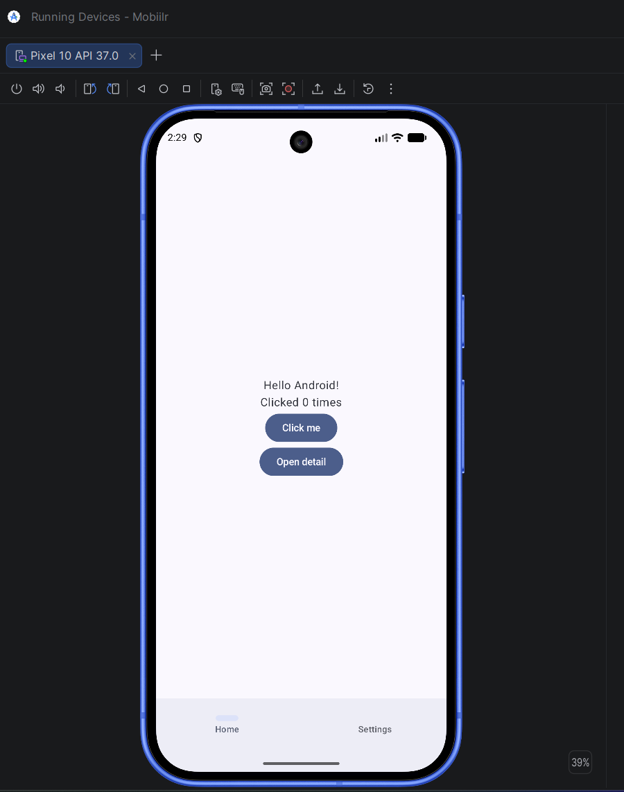
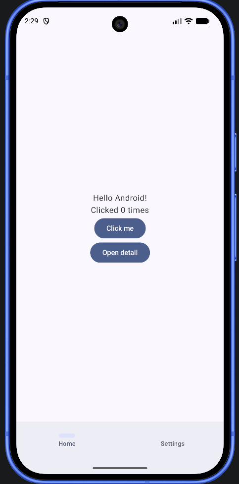
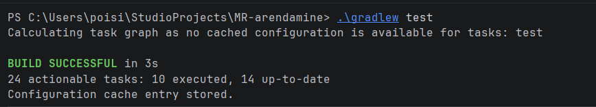
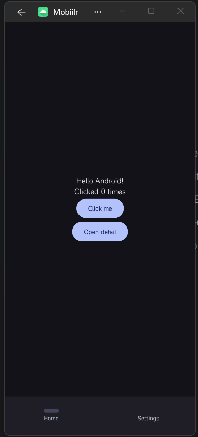
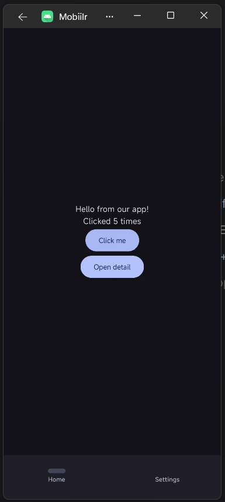
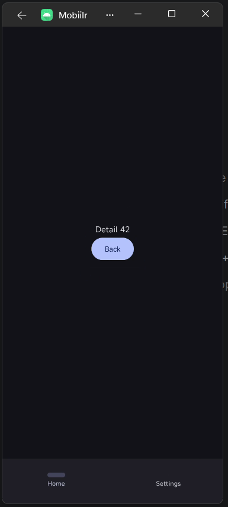
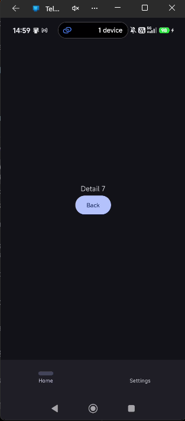

# Testimine

Selles dokumendis on kirjas, millised testid projektis on, kus need asuvad, mida need kontrollivad ja kuidas neid käivitada. Lisaks on kirjeldatud sügavlingi (`myapp://detail/{id}`) käsitsi kontrollimine.

## Testide tüübid

Projektis on kahte tüüpi teste:

| Tüüp | Kaust | Kus jookseb | Mida testib |
| --- | --- | --- | --- |
| Ühiktestid (unit tests) | `app/src/test/` | Arvutis (JVM), seadet pole vaja | `AppViewModel`'i loogikat |
| UI testid (instrumented tests) | `app/src/androidTest/` | Emulaatoris või telefonis | Päris rakenduse navigeerimist ja sügavlinki |

Android Studio *Android* vaates on need kaustad nähtavad nimedega `com.example.mobiilr (test)` ja `com.example.mobiilr (androidTest)`.

## Failide asukohad

```
app/src/
├── main/
│   ├── AndroidManifest.xml              ← sügavlingi intent-filter
│   └── java/com/example/mobiilr/
│       ├── AppNav.kt                    ← navigatsioon ja navDeepLink
│       └── AppViewModel.kt              ← testitav ViewModel
├── test/java/com/example/mobiilr/
│   ├── AppViewModelTest.kt              ← ViewModel'i ühiktestid
│   ├── SampleSizeTest.kt                ← kaamerapildi vähendamise test (vt camera.md)
│   └── ExampleUnitTest.kt               ← malli näidistest
└── androidTest/java/com/example/mobiilr/
    ├── NavigationTest.kt                ← navigatsiooni ja sügavlingi UI testid
    └── ExampleInstrumentedTest.kt       ← malli näidistest
```

## Ühiktestid – `AppViewModelTest.kt`

Testivad `AppViewModel`'i olekut ja sündmust `onGreetClicked()`. Iga testi eel luuakse uus `AppViewModel` (`@Before`), nii et testid ei mõjuta üksteist. Kasutusel on tavaline JUnit 4, lisateeke pole vaja, sest ViewModel ei kasuta korutiine.

| Test | Mida kontrollib |
| --- | --- |
| `algolek_onVaikevaartustega` | Algolekus on sõnum „Hello Android!" ja loendur 0 |
| `onGreetClicked_muudabSonumitJaSuurendabLoendurit` | Pärast ühte vajutust on sõnum „Hello from our app!" ja loendur 1 |
| `onGreetClicked_mitmeKordselVajutamiselLoendurKasvab` | Pärast kolme vajutust on loendur 3 |
| `uusViewModel_alustabPuhtaltOlekult` | Uus ViewModel ei jaga olekut eelmisega |

## UI testid – `NavigationTest.kt`

UI testid käivitavad päris rakenduse (`MainActivity`) seadmes, vajutavad nuppe ja kontrollivad, mis ekraanil näha on. Kasutusel on Compose'i testiteek (`createAndroidComposeRule`).

### `NavigationTest` – navigeerimine

| Test | Sammud | Oodatud tulemus |
| --- | --- | --- |
| `rakendusAvanebAvaekraanil` | Käivita rakendus | Näha on „Hello Android!" ja „Open detail" |
| `openDetail_viibDetailvaatesse` | Vajuta „Open detail" | Näha on „Detail 42" |
| `backNupp_viibTagasiAvaekraanile` | „Open detail" → „Back" | Avaekraan on tagasi |
| `settingsVaheleht_naitabJagatudOlekut` | „Click me" → vaheleht „Settings" | Näha on „Home button clicked 1 times" (ekraanid jagavad sama ViewModel'it) |
| `homeVaheleht_viibSettingsistTagasi` | Vaheleht „Settings" → vaheleht „Home" | Avaekraan on tagasi |

### `DeepLinkTest` – sügavlink

| Test | Sammud | Oodatud tulemus |
| --- | --- | --- |
| `sugavlink_avabDetailvaateOigeId_ga` | Käivita rakendus URL-iga `myapp://detail/5` | Näha on „Detail 5" |

Sügavlingi testis kasutatakse meelega id-d 5, mitte 42. Nupp „Open detail" avab alati „Detail 42", seega id 5 saab tulla ainult URL-ist.

## Testide käivitamine

### Android Studios

1. Ava testifail (nt `AppViewModelTest.kt` või `NavigationTest.kt`).
2. Vajuta rohelist ▶ nuppu klassi nime kõrval (kõik testid) või funktsiooni kõrval (üks test).
3. UI testide puhul vali seade (emulaator või telefon).
4. Tulemused on all Run-paneelis, roheline linnuke tähendab, et test läbis.

Kõiki ühe kausta teste saab käivitada, kui teha kaustal paremklõps → Run 'Tests in ...'.

### Käsurealt

Ühiktestid (seadet pole vaja):

```powershell
.\gradlew test
```

UI testid (emulaator või telefon peab olema ühendatud):

```powershell
.\gradlew connectedAndroidTest
```

`connectedAndroidTest` jooksutab testid korraga kõigis ühendatud seadmetes. Kui on vaja ainult ühte seadet, määra see enne käivitamist (seadme nime näeb käsuga `adb devices`):

```powershell
$env:ANDROID_SERIAL = "emulator-5554"
.\gradlew connectedAndroidTest
```

### Testiraportid

Pärast käsurealt käivitamist tekivad HTML-raportid, mida saab brauseris avada:

| Testid | Raport |
| --- | --- |
| Ühiktestid | `app/build/reports/tests/testDebugUnitTest/index.html` |
| UI testid | `app/build/reports/androidTests/connected/debug/index.html` |

UI testide raportis on tulemused eraldi iga seadme kohta.

## Sügavlingi käsitsi kontrollimine

Sügavlink on seadistatud kahes kohas:

- `AndroidManifest.xml` – `MainActivity` juures on `intent-filter` (`VIEW`, `DEFAULT`, `BROWSABLE`, `scheme="myapp"`, `host="detail"`). See ütleb Androidile, et rakendus avab `myapp://detail/...` lingid.
- `AppNav.kt` – marsruudil `detail/{id}` on `navDeepLink { uriPattern = "myapp://detail/{id}" }`. See ütleb navigatsioonile, millisele ekraanile link viib.

Kontrollimiseks paigalda rakendus seadmesse ja käivita:

```powershell
adb shell am start -W -a android.intent.action.VIEW -d "myapp://detail/7" com.example.mobiilr
```

Rakendus peab avanema kohe ekraanil „Detail 7". Mitme seadme korral lisa seadme valik: `adb -s SEADME_NIMI shell am start ...`.

Kui `adb` käsku ei leita, kasuta täisteed: `& "$env:LOCALAPPDATA\Android\Sdk\platform-tools\adb.exe"`.

Vigade tähendus:

- `Error: Activity not started, unable to resolve Intent` – viga on `intent-filter`'is, Android ei leia rakendust, mis lingi avaks.
- Rakendus avaneb, aga näitab avaekraani – `intent-filter` töötab, aga `navDeepLink` ei klapi.

Teine võimalus: Android Studios Run → Edit Configurations → Launch: URL ja sisesta `myapp://detail/7`.

## Testkeskkonnad

- Virtuaalseade: Android Emulator, Pixel 10, API 37
- Füüsiline seade: Xiaomi 15T

## Ekraanipildid

### Emulaator (Pixel 10, API 37)

Avaekraan Android Studio Running Devices aknas:



Avaekraan:



Ühiktestide käivitamine käsuga `.\gradlew test`:



### Füüsiline seade (Xiaomi 15T)

| # | Samm | Oodatud tulemus | Tulemus |
| --- | --- | --- | --- |
| 1 | Käivita rakendus | Avaekraan: „Hello Android!", „Clicked 0 times" | Töötab |
| 2 | Vajuta „Click me" mitu korda | „Hello from our app!" ja loendur kasvab | Töötab |
| 3 | Vajuta „Open detail" | Avaneb „Detail 42" | Töötab |
| 4 | Ava sügavlink `myapp://detail/7` | Rakendus avaneb kohe ekraanil „Detail 7" | Töötab |

Avaekraan:



Pärast viit vajutust nupule „Click me":



Detailvaade nupu „Open detail" kaudu:



Detailvaade sügavlingi `myapp://detail/7` kaudu:



## Probleemid ja lahendused

**UI testid kukkusid kõik kohe läbi** veaga `NoSuchMethodException: android.hardware.input.InputManager.getInstance`. Põhjus oli vana Espresso versioon (3.5.1), mis ei tööta uuemate Androidi versioonidega. Lahendus oli failis `gradle/libs.versions.toml` tõsta `espressoCore` versioonile 3.7.0 ja `junitVersion` (androidx.test.ext:junit) versioonile 1.3.0. Pärast muutmist tuleb Android Studios teha Sync Project with Gradle Files.

**Android Studio näitas `AppNav.kt` failis viga `Unresolved reference 'navigation'`**, kuigi projekt kompileerus. See oli Android Studio indekseerimise probleem, mitte koodiviga. Aitab File → Sync Project with Gradle Files, vajadusel File → Invalidate Caches → Invalidate and Restart. Kontrolli ka, et Android Studios oleks avatud projekti juurkaust `MR-arendamine`, mitte `app/src`.

**Rakendus ei paigaldunud telefoni** veaga `INSTALL_FAILED_USER_RESTRICTED: Installation via USB is disabled`. Telefon keelab USB kaudu paigaldamise. Lahendus on telefoni Developer options all lubada paigaldamine USB kaudu (Xiaomi: Install via USB; Samsung: lülita välja Auto Blocker menüüs Security and privacy).
